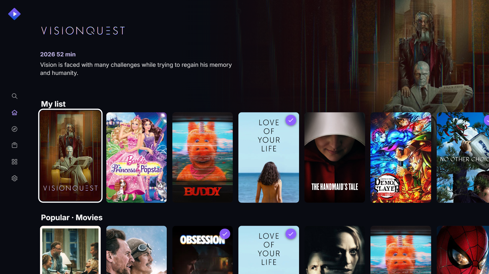

# StremCompat for LG webOS

<p align="center">
  
</p>

<p align="center">
  <a href="https://github.com/Alexesmm/stremcompat-lg-webos/releases"></a>
  
  
  
  
  
  <a href="https://github.com/Alexesmm/stremcompat-lg-webos/discussions"></a>
</p>

## About

StremCompat is an unofficial, remote-friendly Stremio compatibility client for older LG televisions that are not supported by the current LG Content Store application. It installs through LG Developer Mode and webOS Dev Manager and does **not** require root access, Homebrew Channel or a permanent system modification.

The project provides separately optimized builds for incompatible webOS generations and for both webOS-supported application graphics modes, 1920x1080 and 1280x720. The 1280x720 editions are the 720p/HD interface builds and also cover LG televisions with physical 1366x768 panels. StremCompat combines its own lightweight, remote-first television interface with a verified ARMv7 Node.js runtime, FFmpeg tools, a local compatibility server, account and addon synchronization, source filtering and native hardware-backed HTML5 playback.

The goal is not to claim universal support. It is to provide reproducible, testable ports for legacy LG hardware and clearly distinguish physically confirmed televisions from compatibility candidates.

This project is not affiliated with or endorsed by Stremio or LG Electronics. Use only addons and media sources that you are authorized to access.

## Table of contents

1. [About](#about)
2. [Downloads](#downloads)
3. [Expected compatibility by television family](#expected-compatibility-by-television-family)
4. [Why separate builds are required](#why-separate-builds-are-required)
5. [Architecture](#architecture)
6. [webOS 3 adaptation](#webos-3-adaptation)
7. [Features](#features)
8. [Performance profile and image-quality trade-offs](#performance-profile-and-image-quality-trade-offs)
9. [Feedback and compatibility reports](#feedback-and-compatibility-reports)
10. [Installation](#installation)
11. [Choosing and adapting a build](#choosing-a-build-for-another-television)
12. [Verification performed by the build](#verification-performed-by-the-build)
13. [Playback limits](#playback-limits)
14. [Troubleshooting](#troubleshooting)
15. [Releases](#releases)
16. [What StremCompat adds](#what-stremcompat-adds)
17. [Credits and licensing](#credits-and-licensing)

## Downloads

Use the IPK that matches both the television generation and the application graphics mode. StremCompat 1.1.0 publishes four clearly named assets on the [Releases page](https://github.com/Alexesmm/stremcompat-lg-webos/releases).

| Build | Graphics mode | Status | Confirmed television | Platform | Application shown on TV |
|---|---:|---|---|---|---|
| `um4-armv7` 1.2.12 | 1920x1080 | Confirmed | LG 50UM7500PSB, firmware 05.40.97 | webOS 4.x, Chromium 53, ARMv7 | Stremio |
| `um4-armv7-hd` 1.2.12 | 1280x720 (720p/HD; also 1366x768 panels) | Locally validated; physical reports requested | Not yet confirmed | webOS 4.x, Chromium 53, ARMv7 | Stremio HD |
| `uj3-native-armv7` 1.0.11 | 1920x1080 | Confirmed | LG 49UJ6565-SB, webOS 3.9.3-6280413 (`dreadlocks2-dudhwa`) | webOS 3.x, Chromium 38, ARMv7 | Stremio UJ3 |
| `uj3-native-armv7-hd` 1.0.11 | 1280x720 (720p/HD; also 1366x768 panels) | Locally validated; physical reports requested | Not yet confirmed | webOS 3.x, Chromium 38, ARMv7 | Stremio UJ3 HD |

Release assets:

- `StremCompat-webOS4-UM4-armv7-graphics-1920x1080-1.2.12.ipk`
- `StremCompat-webOS4-UM4-armv7-graphics-1280x720-1.2.12.ipk`
- `StremCompat-webOS3-UJ3-armv7-graphics-1920x1080-1.0.11.ipk`
- `StremCompat-webOS3-UJ3-armv7-graphics-1280x720-1.0.11.ipk`

First choose UJ3 for webOS 3.x or UM4 for webOS 4.x. Then choose the graphics mode:

- Use `graphics-1920x1080` on a television where the existing StremCompat interface already fills the screen correctly.
- Use `graphics-1280x720` as the general 720p/HD interface edition. It is intended for physical 1280x720 and 1366x768 panels, televisions that support only 1280x720 web applications, and cases where the 1920 package occupies only the upper-left portion of the screen.
- A physical 1366x768 panel must use the `graphics-1280x720` package because webOS scales the 1280x720 application surface to that panel. `1366x768` itself is not a supported webOS application resolution.
- The graphics mode affects the interface only. It does not limit native video playback to 720p.

LG officially supports `1920x1080` and `1280x720` as web-application graphics resolutions and recommends separate packages where both modes are needed. See [LG Supported App Resolution](https://webostv.developer.lge.com/develop/specifications/app-resolution) and the [`appinfo.json` resolution reference](https://webostv.developer.lge.com/develop/references/appinfo-json).

The older `uj3-armv7` 0.9.3 profile is retained only as development history. It was replaced by `uj3-native-armv7` and is not a recommended release.

Do not use these packages on ARM64-only televisions or webOS 1.x/2.x. Televisions using webOS 5 or newer should normally use the official Stremio application when it is available.

## Expected compatibility by television family

The two televisions in the Downloads table are the only physically confirmed models so far. The families below are **compatibility candidates**, not a claim that every regional or screen-size variant has been tested. LG can change processors, memory and loaders inside a model family, so the webOS version is the first filter and the ARM architecture is the second.

| Build | Expected webOS generation | Candidate LG families and examples |
|---|---|---|
| UJ3 1920x1080 or 1280x720 | webOS 3.0, generally 2016 models | OLED B6, C6, E6 and G6; LCD families UH95, UH85, UH77, UH76, UH65, UH63, UH61, UH60 and LH60 |
| UJ3 1920x1080 or 1280x720 | webOS 3.5, generally 2017 models | OLED B7, C7, E7, G7 and W7; LCD families SJ95, SJ85, SJ80, UJ75, UJ70, UJ67, UJ65, UJ63, UJ62, LJ55 and LJ54 |
| UM4 1920x1080 or 1280x720 | webOS 4.0, generally 2018 models | OLED B8, C8, E8, W8 and Z8; LCD families SK95, SK90, SK85, SK80, UK77, UK75, UK65, UK63, UK62, UK61, UK60, LK64, LK61, LK57 and LK54 |
| UM4 1920x1080 or 1280x720 | webOS 4.5, generally 2019 models | OLED B9, C9, E9, W9 and Z9; LCD families SM99, SM95, SM90, SM86, SM81, UM80, UM76, UM75, UM74, UM73, UM72, UM71, UM70, UM69, LM63, LM62, LM57 and LM50 |

Examples such as `49UJ6565-SB`, `55UK6300PUB` and `50UM7500PSB` contain a screen size, family and regional suffix. A matching family prefix is useful evidence, but it does not prove that the CPU and system loader are identical. The definitive check is the information reported by the television itself under **Settings > General > About This TV > webOS TV Version**, followed by a real installation and playback test.

Before trying a candidate model, check all of the following:

1. The television runs webOS 3.x for UJ3 or webOS 4.x for UM4. A firmware number such as `05.40.97` is not the webOS platform version.
2. LG Developer Mode can be enabled and the television can be reached by webOS Dev Manager.
3. The television provides a 32-bit ARMv7 userland and `/lib/ld-linux.so.3`. Some variants can only prove this when the bundled runtime starts.
4. At least approximately 92 MiB of internal storage is available after old test packages are removed.
5. Installation, login, Home catalogs and a moderate H.264/AAC stream are all tested before the model is reported as confirmed.

The family mapping above follows LG's published platform generations: [webOS 3.x uses Chromium 38 and covers the 2016-2017 platform releases](https://webostv.developer.lge.com/develop/specifications/web-api-and-web-engine), while [webOS 4.0 and 4.5 correspond to LG's 2018 and 2019 model families](https://www.lg.com/us/support/help-library/how-to-use-airplay-what-lg-tvs-support-airplay-2-CT10000020-20151097893431). LG's own regional model lists show the representative [2016-2019 OLED and LCD family prefixes](https://www.lg.com/mx/acerca-de-lg/press-and-media/lg-anuncia-incorporacion-de-hbo/). Regional lineups can differ.

When reporting a successful or failed test, include the complete model code and regional suffix, webOS TV version, firmware version, package filename, available storage, startup result and whether login, catalogs and playback worked. This evidence is required before moving a model from candidate to confirmed.

## Why separate builds are required

LG changed the browser engine and available runtime across webOS generations:

| webOS generation | Browser engine | System JavaScript service runtime | Recommended build |
|---|---|---|---|
| webOS 3.x, 2016-2017 | Chromium 38 | Node.js 0.12.2 | `uj3-native-armv7` |
| webOS 4.x, 2018-2019 | Chromium 53 | Node.js 0.12.2 | `um4-armv7` |
| webOS 5 and newer | Newer Chromium versions | Newer platform runtime | Official Stremio app preferred |

Chromium 38 rejects JavaScript syntax and browser APIs that work on newer televisions. Old TV certificate stores can also reject otherwise valid HTTPS services. A single modern web application therefore cannot be assumed to work across all LG generations.

Graphics resolution is a separate compatibility decision. The value is declared in the package manifest before the application starts, so responsive CSS alone cannot correct a package launched with the wrong webOS graphics mode. StremCompat therefore shares one resolution-aware interface implementation while publishing separate `1920x1080` and `1280x720` manifests for each supported webOS generation.

Official references:

- [LG web engine versions](https://webostv.developer.lge.com/develop/specifications/web-api-and-web-engine)
- [LG JavaScript service and Node.js versions](https://webostv.developer.lge.com/develop/guides/js-service-basics)
- [LG TLS and root certificate compatibility](https://webostv.developer.lge.com/develop/specifications/tls)
- [LG webOS 3.5 audio and video formats](https://webostv.developer.lge.com/develop/specifications/video-audio-35)
- [LG streaming protocol and DRM support](https://webostv.developer.lge.com/develop/specifications/streaming-protocol-drm)

## Architecture

The installed package contains two webOS components:

1. A small packaged web application starts immediately and requests the matching Luna service.
2. The Luna service is deliberately written in ES5 so it can run on the TV's Node.js 0.12.2 runtime.
3. The service starts the bundled ARMv7 Node.js 18 runtime with its matching shared libraries.
4. Node.js 18 runs a local compatibility server on `127.0.0.1`.
5. The TV interface, account bridge, addon requests, stream headers, HLS rewriting, subtitles and playback helpers are served from that local origin.
6. The browser uses the television's hardware-backed HTML5 media pipeline for playback.

The UM4 1920x1080 and 1280x720 builds use ports `8082` and `8084`. The UJ3 1920x1080 and 1280x720 builds use ports `8093` and `8094`. Each edition has its own app and service identity, so a test build cannot attach to a stale process from another edition.

## webOS 3 adaptation

The UJ3 edition is not just a renamed UM package. It includes the following changes for Chromium 38 and low-memory 2017 hardware:

- ES5-only interface syntax verified against Chromium 38 rules.
- No block-level strict-mode function declarations, which Chromium 38 rejects.
- Synchronous boot with preserved `UJ3_BOOT` diagnostics.
- Guarded event binding and remote-control focus handling.
- Interface assets embedded inside the local server, with file loading only as the first option. This prevents the former `beta shell missing` failure.
- Stremio account POST requests bridged through local Node.js 18. This avoids relying on the old browser's TLS roots and CORS implementation.
- Addon and metadata GET requests bridged through the same local runtime.
- Reduced catalog, library, source, backdrop and worker limits.
- Smaller 640-pixel backdrops and a six-item backdrop cache.
- Separate application and service identity: `io.strem.tv.uj3native` and `io.strem.tv.uj3native.server`.

The confirmed UJ3 package was tested with the official Chromium 38 snapshot. Startup reached login, remote navigation moved focus correctly, a stored account reached Home, embedded UI fallback worked, and live Cinemeta, Stremio account API and Stremio pairing requests returned valid data.

## Features

- Stremio account login by email or mobile pairing code.
- English first-run interface with Brazilian Portuguese selectable on the login screen or under Settings. The choice is stored on the television and remains independent from account, subtitle and audio preferences.
- Account library, watched state and progress synchronization.
- Account addon synchronization.
- Addon-driven Home, Discover, Search and Library screens. Discover exposes compatible catalogs and genre options declared by the addons synchronized with the account, then loads additional pages as the user approaches the end of the grid.
- A fixed icon-only television sidebar, an independent filterable Discover grid and metadata previews while browsing Home and Search.
- Directional-pad and LG Magic Remote navigation designed specifically for a ten-foot television interface.
- Catalog fault isolation: unavailable or empty addon rows are skipped without trapping remote focus or blocking the remaining Home rows.
- Quality filters for 4K, 1440p, 1080p, 720p, SD and unknown quality.
- Duplicate source removal.
- Descending seeder sorting when an addon exposes a recognizable seeder count.
- Direct video and HLS playback through the local stream bridge.
- Forwarding of required authorization, referer and range headers.
- Audio-track selection, subtitles, resume and watched progress.
- Low-memory behavior tuned separately per profile.

## Performance profile and image-quality trade-offs

StremCompat is intentionally optimized for televisions with old Chromium engines, slow CPUs and limited free memory. It does not attempt to render the same number of full-resolution interface assets as a current streaming box. This is what allows the UI, account data, addons and native player to coexist more reliably on the target televisions.

| Limit | UM4 for webOS 4.x | UJ3 for webOS 3.x |
|---|---:|---:|
| Browsing backdrop width | 960 pixels | 640 pixels |
| Decoded backdrop memory, approximately | 2.0 MiB at 960x540 RGBA | 0.9 MiB at 640x360 RGBA |
| Backdrops retained in the local cache | 24 | 6 |
| Simultaneous backdrop resize workers | 2 | 1 |
| Sources retained per item | 60 | 30 |
| Library items retained in memory | 60 | 30 |
| Catalog items retained per row | 16 | 10 |
| Addon catalog rows retained on Home | 24 | 16 |
| Discover items retained across incremental pages | 80 | 40 |

For comparison, one decoded 1920x1080 RGBA background can occupy about 8 MiB before browser and GPU overhead. Repeated full-resolution backgrounds caused memory pressure and sluggish focus movement on the target hardware. Therefore:

- Backgrounds and some catalog artwork can look softer than they do in a modern desktop or official current-generation application, especially when viewed close to a 4K panel.
- The UM4 edition keeps higher-resolution artwork, a larger cache and more workers because the confirmed 50UM7500PSB handles that profile.
- The UJ3 edition deliberately prefers stability over backdrop sharpness. It uses smaller artwork, fewer cached images, fewer catalog entries and a simpler low-memory transition path.
- Only the focused item's backdrop and logo are warmed ahead of time. Neighboring full-screen backgrounds are not all decoded while the user scrolls.
- Metadata, library, source and paginated Discover lists are capped per profile to prevent a large account or addon response from exhausting the television's memory.
- Backdrop and metadata updates are delayed briefly during rapid remote navigation, and obsolete requests are ignored or cancelled before they can repaint the current selection.
- Account, addon and artwork requests are bridged through the bundled Node.js runtime to avoid legacy browser TLS and CORS failures.
- Video playback still uses the source selected by the user through the television's hardware-backed HTML5 media pipeline. The backdrop limits affect **interface artwork only**; they do not reduce a 1080p or 4K video's resolution.

This tuning cannot add codec support or processing power that the firmware does not have. A visually lighter interface can improve navigation, but unsupported audio, containers, DRM, unusually high bitrates and very large remux files can still fail during playback.

## Feedback and compatibility reports

Use [GitHub Discussions](https://github.com/Alexesmm/stremcompat-lg-webos/discussions) for installation questions, compatibility results and general feedback. Use [GitHub Issues](https://github.com/Alexesmm/stremcompat-lg-webos/issues) for reproducible defects that require a code change.

Before opening a report or pull request, read [CONTRIBUTING.md](CONTRIBUTING.md). The repository provides separate Issue forms for reproducible bugs and completed physical-TV compatibility tests. Ideas, early test results and support requests belong in Discussions so that Issues remain an actionable engineering queue. Security-sensitive reports must follow [SECURITY.md](SECURITY.md) and must never be posted publicly.

Include the following information in every television report:

- Complete television model and regional suffix.
- Full webOS TV version and firmware version.
- Exact IPK filename, including `graphics-1920x1080` or `graphics-1280x720`.
- Available internal storage.
- Whether startup, login, catalogs, remote navigation and playback worked.
- A photograph and the complete error code when the interface is clipped or startup fails.

Do not publish passwords, authentication tokens or active pairing QR codes. The 1280x720 packages are locally validated but remain candidate builds until results are received from physical televisions.

## Installation

Root access is not required. Installation uses LG's standard Developer Mode workflow already described below; the television does not need to be rooted or modified with Homebrew Channel. Because this is a Developer Mode installation, the app remains subject to LG's Developer Mode timer and must be renewed before it expires.

1. Install and open LG's Developer Mode application on the television.
2. Sign in, enable Developer Mode and enable Key Server.
3. Add the television in webOS Dev Manager.
4. Download the IPK matching both the webOS generation and graphics mode from Releases.
5. Install the IPK and open the corresponding application name.

The compressed IPK is approximately 46 MiB. The installed package uses approximately 92 MiB because the runtime and media tools are compressed inside the IPK. Remove obsolete test editions if the television has limited internal storage.

> **Important after installing an update over an existing StremCompat build:** older LG televisions can keep the previous Luna service and local runtime alive through Quick Start+. The updated app may consequently stay on the loading screen, request reinstallation or fail to connect to its local service even though webOS Dev Manager reported a successful installation. If this happens, close the app, turn the television off, unplug it from power for at least 30 seconds, reconnect it and open StremCompat again. Reinstall the IPK only if the problem remains after this complete power cycle. This does not normally erase the Stremio account or settings stored by the app.

This behavior is most commonly seen with Developer Mode updates installed over the same application ID. Merely putting the television in standby may not help because Quick Start+ can preserve the old process in memory.

Developer Mode installations expire with the Developer Mode timer and may be removed by the television after expiry. Renew the timer before it reaches zero.

## Choosing a build for another television

Use the webOS TV version shown in the television information screen, not the firmware number by itself. Then select the graphics mode separately.

- Choose UJ3 for a 2016-2017 ARMv7 television running webOS 3.x and Chromium 38.
- Choose UM4 for an ARMv7 television running webOS 4.x and Chromium 53.
- Choose 1920x1080 graphics when the interface fills the screen correctly; choose 1280x720 graphics when a 1920 package is confined to the upper-left portion of the display.
- For a 1366x768 television panel, choose the 1280x720 graphics package.
- Do not assume that every model in a marketing family has the same processor.
- The bundled runtime requires a 32-bit ARMv7 CPU and the soft-float loader at `/lib/ld-linux.so.3`.
- A model that is ARM64-only, x86 or missing that loader needs a different runtime build.

Models similar to a confirmed television are compatibility candidates, not confirmed devices. Add a television to the confirmed table only after installation, account login, catalog loading and playback have been tested on the physical device.

## Adapting the project to another TV

Requirements on the build computer:

- Windows PowerShell
- A supported Node.js version
- npm
- Network access for the first runtime download

Install dependencies and build the confirmed profiles:

```powershell
npm ci
npm run runtime
npm run package:um4
npm run package:um4-hd
npm run package:uj3-native
npm run package:uj3-native-hd
```

The first runtime preparation downloads a pinned StremioBrew package, verifies SHA-256 `36c81015d851bfd4b12c40372edbe7b51fb67fe1d8cec828d0aeFA6CE8343DF7` case-insensitively, and extracts the required ARMv7 runtime files. Runtime binaries are not committed to this repository. The original upstream file was removed after version 2.0.0 replaced that architecture, so an unchanged checksum-verified copy is retained in the `runtime-v1.0.0` build-dependency prerelease. It is not a TV application download.

To add another profile:

1. Copy the closest JSON file from `profiles/`.
2. Give the profile a unique `profile`, `appId`, `serviceId` and localhost `port`.
3. Set `graphicsResolution` to either `1920x1080` or `1280x720`. Do not use the physical panel resolution `1366x768` in the manifest.
4. Set `ecmaTarget` to `chrome38` for webOS 3.x or `chrome53` for webOS 4.x.
5. Keep `lowMemory` enabled for older televisions.
6. Reduce `sourceCap`, `libraryCap`, `catalogCap`, backdrop width, cache and workers for weak hardware.
7. Build with the new profile name:

```powershell
powershell -ExecutionPolicy Bypass -File scripts/build.ps1 -Profile your-profile
```

8. Test the resulting IPK on the physical television before declaring it compatible.

## Verification performed by the build

The build fails when it detects an incompatible or incomplete package. It checks:

- ES5 syntax for the system Node.js 0.12 launcher.
- Browser syntax for the selected Chromium target.
- Chromium 38 strict-mode function placement.
- Application and service IDs, versions and local ports.
- Supported `1920x1080` or `1280x720` graphics resolution in the staged manifest and final IPK.
- Resolution-aware card-row calculations at both viewport widths.
- Embedded UI byte equality with the packaged UI files.
- ARM32 little-endian ELF headers.
- Executable permissions for Node.js, FFmpeg and FFprobe inside the IPK.
- Presence of the account, addon, HLS and protected stream bridges.
- Package manifests and final IPK contents.

Additional local tests exercise startup, remote focus, login/Home transitions, storage failures, addon requests, protected headers and relative HLS rewriting. The Chromium 38 integration test requires the official legacy Chromium snapshot in the local test cache.

`npm run test:visual:layouts` builds all four profiles, opens each staged interface in a local browser at its declared viewport, verifies the login layout and a 14-catalog Home with interleaved addon failures, checks that remote navigation skips failed rows, and saves screenshots under `.build/visual-tests/`. This is a local layout check, not a substitute for physical-TV confirmation.

## Playback limits

The application cannot expand the codecs or processing power available in the television firmware.

- Prefer direct or debrid sources using H.264 or television-supported HEVC with AAC or AC3.
- Very large 4K remux files, unsupported audio codecs and high bitrates can fail or exhaust memory.
- Addon availability, source metadata and seeder counts are controlled by external addon services.
- Seeder sorting works only when the addon exposes a recognizable number.
- Some HLS tags and multi-audio behavior are limited on webOS 3.x.
- DRM playback remains subject to the firmware's MSE, EME, Widevine and PlayReady versions.

## Troubleshooting

- Confirm that the correct application was opened. The dedicated webOS 3 edition is named `Stremio UJ3`.
- **After updating an existing installation:** if the app no longer loads, asks to be reinstalled or cannot start its local service, close it, turn the television off, unplug it for at least 30 seconds and then reconnect it. A normal standby restart may preserve the previous runtime through Quick Start+.
- If the whole application occupies only the upper-left portion of the television, install the matching `graphics-1280x720` package instead of changing the TV picture settings.
- Remove superseded test editions if storage is low.
- Verify that Developer Mode is still active.
- If an error screen appears, record the complete `UJ3_BOOT` or `UJ3_ASSET` message before reinstalling.
- A source that appears but does not play is usually a codec, container, bitrate, header or addon issue rather than an application startup problem.
- Test a moderate H.264/AAC direct source before diagnosing large 4K or torrent sources.

## Releases

Builds are released together under the StremCompat project version. Tags follow Semantic Versioning, such as `v1.0.4`. Each television port keeps its own internal version in the asset filename because the ports can evolve independently. The GitHub Actions release workflow builds all four generation-and-resolution combinations, verifies them, gives them descriptive filenames and attaches them to the matching GitHub Release.

Maintainer example:

```powershell
git tag v1.0.4
git push origin v1.0.4
```

Users do not need to create a Release. They only download the matching IPK from the Releases page.

## What StremCompat adds

StremCompat is an independent compatibility and integration project for running a modern Stremio experience on older LG webOS televisions. It is not merely a renamed or repackaged copy of one upstream project. Its current interface is developed specifically for StremCompat and for remote-controlled legacy televisions. The project combines that interface with carefully adapted bootstrap and runtime components so the resulting ports can actually boot, sign in, load addons and play media within the limits of legacy LG hardware.

The project adds and maintains:

- Separate, reproducible builds for incompatible webOS generations instead of one package with assumed universal support.
- A bundled and verified ARMv7 runtime with generation-specific launch services, identities and local ports.
- An ES5/Chromium 38 adaptation for webOS 3.x, including startup diagnostics and an embedded interface fallback.
- Account, addon, metadata, artwork, protected-stream and HLS bridges that avoid legacy browser TLS and CORS limitations.
- A remote-control television interface with source quality filters, duplicate removal and seeder-aware sorting.
- A custom low-memory UI with a fixed sidebar, filterable Discover view, contextual metadata previews and horizontal episode browsing.
- Native hardware-backed television playback with subtitles, audio-track selection, resume and watched-state synchronization.
- Different memory, artwork and catalog profiles for webOS 3.x and 4.x televisions.
- Automated package checks plus documented physical-device validation and compatibility reporting.

That interface work, integration, legacy-browser engineering, device profiling, packaging and testing are the reason StremCompat exists. The upstream projects remain important technical foundations and are credited below; StremCompat is the maintained compatibility client that connects and adapts them for specific older LG televisions.

## Credits and licensing

The current StremCompat television interface is maintained within this project. Its packaged-app bootstrap began from [kieranbrown/stremio-webos](https://github.com/kieranbrown/stremio-webos); that repository identifies [NoobyGains/stremio-vidaa-tv](https://github.com/NoobyGains/stremio-vidaa-tv) in its earlier interface lineage. The bundled local runtime approach was adapted from [StremioBrew](https://github.com/simussu9-wq/stremiobrew). Stremio, Node.js, FFmpeg and LG webOS tooling are also used or interoperated with.

See [NOTICE.md](NOTICE.md) for the project lineage and the current redistribution caveats, and [THIRD_PARTY.md](THIRD_PARTY.md) for component-level provenance. No repository-wide open-source license is currently asserted while inherited source without a published license remains in the tree. Third-party names, trademarks, binaries and source code remain subject to their respective licenses and terms.
