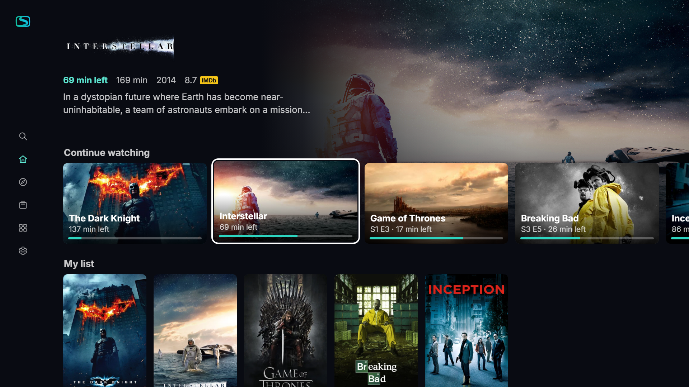
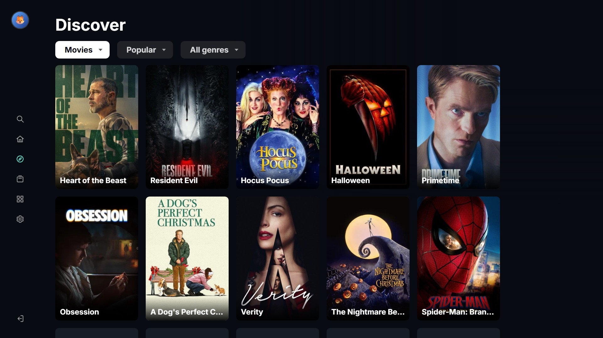
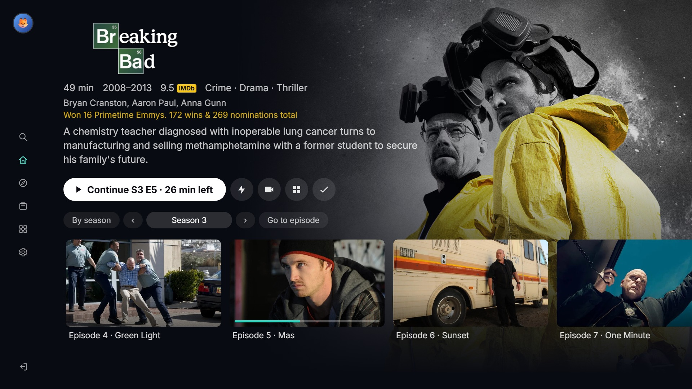
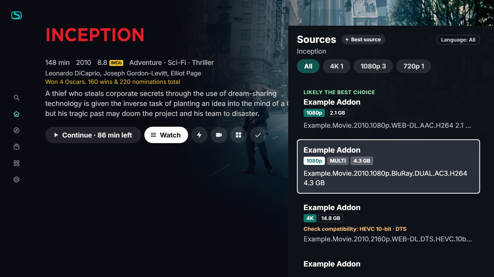
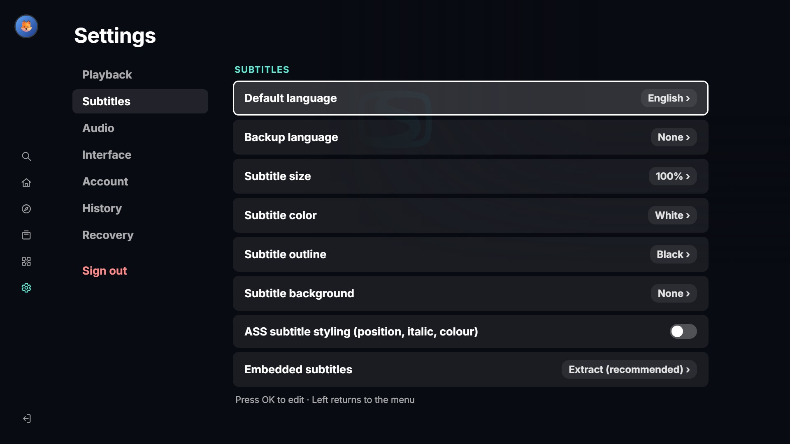

# StremCompat for LG webOS

  

  
  
  
  
  
  
  
  

## About

StremCompat is an independent, unofficial client for older LG TVs that cannot install the official Stremio app. It works with your own Stremio account and addons, with an interface made for the TV remote. It needs no root and no computer, not even for torrents, and the whole package is about 6 MB.

**The stable version is the one for LG.** There is also a [test version for older Samsung TVs](#samsung-tvs-test-version).

This project is not affiliated with or endorsed by Stremio, LG Electronics or Samsung. Use only addons and media sources that you are authorized to access.

## Features

- **Your Stremio account:** sign in with a QR code or email. Library, progress, watched state and addons stay in sync with your other Stremio apps.
- **Browsing:** Home, Discover, Search and Library from your addons, with Continue Watching and the minutes left.
- **Best source:** one press goes straight to the video. It asks which quality you want, or uses the one set in Settings.
- **Source list:** quality and language filters, compatibility warnings, and addons that fail are named. Each source is tagged TORRENT, DEBRID (with its service, such as RD or TB) or DIRECT. Settings can sort the list by provider, or put debrid links first.
- **Playback:** direct, debrid, torrent and HLS, using the TV's hardware decoder. Torrents play on the TV itself, or through a streaming server on another computer if you prefer.
- **Subtitles and audio:** from addons or inside the file, remembered for each title, with a backup language and a subtitle delay.
- **Series:** the next episode starts with the same release or a matching source, with an "are you still watching?" check.
- **Made for the TV:** remote and Magic Remote, color-button shortcuts and optional larger text.
- **Seven languages:** English, Brazilian Portuguese, Spanish, French, German, Italian and Russian, following the TV's language at first. Corrections to the translations are welcome.
- **Your control:** **Do not save history** keeps progress and searches off the TV and your account, and **Settings > Diagnostics** shows memory and recent problems.

## Screenshots

Captured from the real interface at 1920x1080, on a computer, with a demo library and an example addon.

<table>
  <tr>
    <td></td>
    <td></td>
  </tr>
  <tr>
    <td></td>
    <td></td>
  </tr>
</table>

## Installation

There are two packages, and the video looks the same in both:

- **1080p**, sharper, for Full HD and 4K screens.
- **720p**, for smaller screens such as 1366x768, where the 1080p interface would be cut off. It also uses less memory.

**With the Homebrew Channel**, which also makes updates easy:

1. Install the [Homebrew Channel](https://github.com/webosbrew/webos-homebrew-channel) on the TV.
2. In its settings, add one repository:
   - 1080p: `https://alexesmm.github.io/stremcompat-lg-webos/apps.json`
   - 720p: `https://alexesmm.github.io/stremcompat-lg-webos/720/apps.json`
3. Install StremCompat from the channel. The app tells you when a new version is out.

**With Developer Mode:**

1. Install LG's **Developer Mode** app on the TV, sign in, and enable Developer Mode and Key Server.
2. Add the TV in **webOS Dev Manager**.
3. Download `StremCompat-v3.0.5-1080p.ipk` or `StremCompat-v3.0.5-720p.ipk` from the [Releases page](https://github.com/Alexesmm/stremcompat-lg-webos/releases) and install it.

Developer Mode installations expire with its timer, so renew it before it reaches zero.

The app uses about 13 MB once installed, plus up to 768 MB of free storage while a torrent plays, which is cleared when it stops.

> **Coming from 2.x?** If you used `StremCompat`, this updates it. If you used `StremCompat HD`, `StremCompat UJ3` or `StremCompat UJ3 HD`, remove that app and install the package for your screen: it replaces all of them. You may need to sign in again.

### First use

StremCompat has no accounts or sources of its own.

1. Create a free account at [stremio.com/register](https://www.stremio.com/register), if you do not have one.
2. Install your addons in the Stremio app or website. Without an addon that provides sources, titles open but have nothing to play.
3. On the TV, sign in with the QR code or with your email and password.

## Compatibility

StremCompat targets LG televisions with an ARM processor running **webOS 3.x and 4.x**, roughly the 2016-2019 models, the ones that cannot install the official app. Newer versions should work and reports are welcome.

| webOS | Typical years | Example families |
|---|---|---|
| 3.0 / 3.5 | 2016-2017 | OLED B6/C6/E6/G6, B7/C7/E7/G7/W7; LCD UH6x-UH9x, SJ8x-SJ9x, UJ6x-UJ7x, LJ5x |
| 4.0 / 4.5 | 2018-2019 | OLED B8/C8/E8/W8/Z8, B9/C9/E9/W9/Z9; LCD SK8x-SK9x, UK6x-UK7x, SM8x-SM9x, UM69-UM80, LK5x-LK6x, LM5x-LM6x |

webOS 1.x and 2.x are not supported. LG can change processors inside a family, so a model not listed below is a candidate until someone reports it.

### Tested televisions

| Television | webOS / firmware | App version | Result | Source |
|---|---|---|---|---|
| LG 50UM7500PSB | 4.x | 3.0.0 | Working | Maintainer |
| LG 49UJ6565-SB | 3.9.3 | 3.0.0 | Working | Maintainer |
| LG 43LH600T | 3.4.3 / 05.70.50 | 2.1.0, 1280x720 | Working; Magic Remote not tested | User report |
| LG UJ6300 | Not stated | Not stated | Working so far | User report |
| LG OLED C9 | Not stated | Not stated | Working | User report |
| Not stated | 4.5 | Not stated | Working | User report |
| Not stated | 7.0.0 / 4.60.90 | Not stated | Working | User report |

Most reports come from versions before 3.0, whose packages were different, so a new report helps even for a model on this list. Tried it on another TV? [Send a compatibility report](https://github.com/Alexesmm/stremcompat-lg-webos/issues/new?template=compatibility-report.yml).

## How it works

A small webOS launcher starts a local server on the TV's own Node.js. The interface, addon requests and subtitles go through it, which avoids the old browser's TLS and CORS limits, and video uses the TV's hardware decoder.

Two small programs built from source come with it: FFmpeg, for artwork, seek previews and subtitles inside the video, and a torrent engine over [Nuvio Engine](https://github.com/NuvioMedia/nuvio-engine) and libtorrent. Details are in [docs/TECHNICAL.md](docs/TECHNICAL.md).

## Samsung TVs (test version)

> **This is a test version.** It has only been tested on one TV (Samsung UN75NU7100, Tizen 4.0), so expect problems. The stable version is the one for LG webOS.

| Samsung TVs | Tizen | Status |
|---|---|---|
| 2018, N series | 4.0 | Tested on one TV |
| 2017, M series | 3.0 | Should work, not tested yet |
| 2019 and 2020, R and T series | 5.0 and 5.5 | May work, not tested |
| 2021 and 2022 | 6.0 and 6.5 | May work, not tested; these TVs can use the official Stremio app |
| 2023 and newer | 7.0 and newer | Not tested; the package has to be signed again with your own Samsung certificate |
| 2015 and 2016 | 2.x | Not supported |

It differs from the LG version in a few ways:

- **Torrents** need a streaming server on another computer: **Settings > Streaming server > Address**. Debrid and direct links work without one.
- **Not available:** seek previews, technical badges on the paused screen and background trailers, which depend on FFmpeg.

Download the package from the [test release](https://github.com/Alexesmm/stremcompat-lg-webos/releases/tag/tizen-beta-2), which has the installation steps. Please report how it went with your TV model and Tizen version in [Discussions](https://github.com/Alexesmm/stremcompat-lg-webos/discussions).

## Troubleshooting

- **Interface cut off or only in part of the screen:** use the 720p package. On the Homebrew Channel, remove the repository you added and add the 720p address from [Installation](#installation). If it still shows the old version, uninstall the app first.
- **"Can't reach Stremio", or nothing loads while other apps work:** your network probably hands out IPv6 without a working connection. Turn IPv6 off on the TV (Settings > Network > Wi-Fi or Wired connection > Advanced settings > IPv6) or on the router.
- **App stuck on the loading screen after an update (`RUNTIME_START_TIMEOUT`):** unplug the TV for at least 30 seconds and open it again. The remote is not enough when Quick Start+ is on. This does not erase your account or settings.
- **Torrents do not start, but debrid and direct links work:** **Settings > Diagnostics** shows the state of the engine. Few seeders or little free storage can also keep a torrent from starting.
- **A source appears but does not play:** usually a codec, bitrate or addon issue. Try a moderate H.264/AAC source first.
- **Error screen at startup:** note the full `APP_BOOT` or `APP_ASSET` message before reinstalling.

## Feedback and support

Use [Discussions](https://github.com/Alexesmm/stremcompat-lg-webos/discussions) for questions, ideas and compatibility results, and [Issues](https://github.com/Alexesmm/stremcompat-lg-webos/issues) for reproducible bugs. See [CONTRIBUTING.md](CONTRIBUTING.md) first, and [SECURITY.md](SECURITY.md) for security issues. Never post passwords, tokens or an active pairing QR code.

StremCompat is free and made in my spare time. If it has been useful to you, you can [buy me a coffee ☕](https://buymeacoffee.com/Alexesmm), which is entirely optional.

## Credits and licensing

- **[StremioBrew](https://github.com/simussu9-wq/stremiobrew)**: StremCompat started from its 1.0.0 package and has since been rewritten. See [NOTICE.md](NOTICE.md).
- **[kieranbrown/stremio-webos](https://github.com/kieranbrown/stremio-webos)**: StremCompat started as a fork of this project, whose earlier interface came from [NoobyGains/stremio-vidaa-tv](https://github.com/NoobyGains/stremio-vidaa-tv). The launcher and interface have since been rewritten.
- [Nuvio Engine](https://github.com/NuvioMedia/nuvio-engine) and libtorrent power the torrent engine. FFmpeg, the Inter typeface and LG webOS tooling are also used. Stremio is a trademark of its owner.

StremCompat is licensed under [GPL-3.0](LICENSE). The license does not cover other third-party components, or the names and logos of StremCompat, Stremio, LG and Samsung. See [NOTICE.md](NOTICE.md) and [THIRD_PARTY.md](THIRD_PARTY.md) for project lineage, component provenance and open items.
